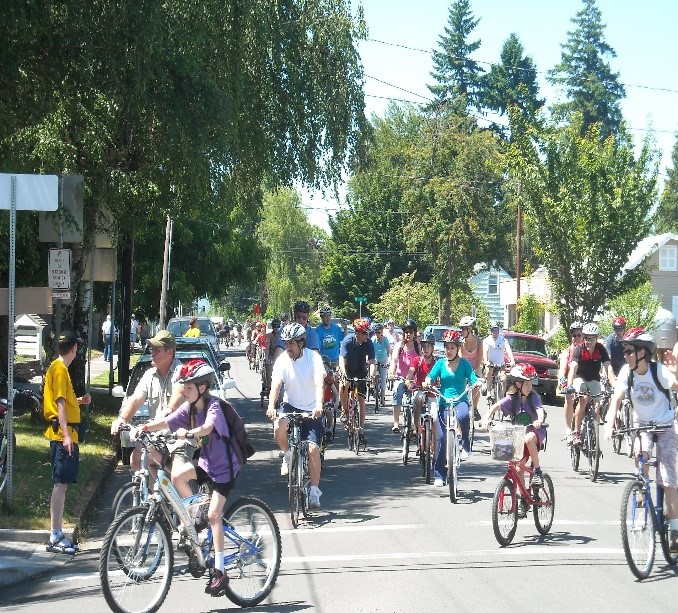
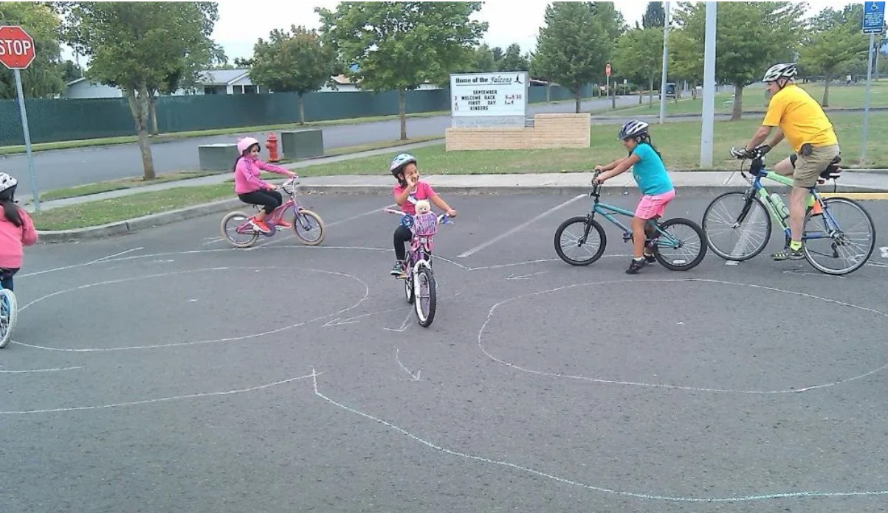
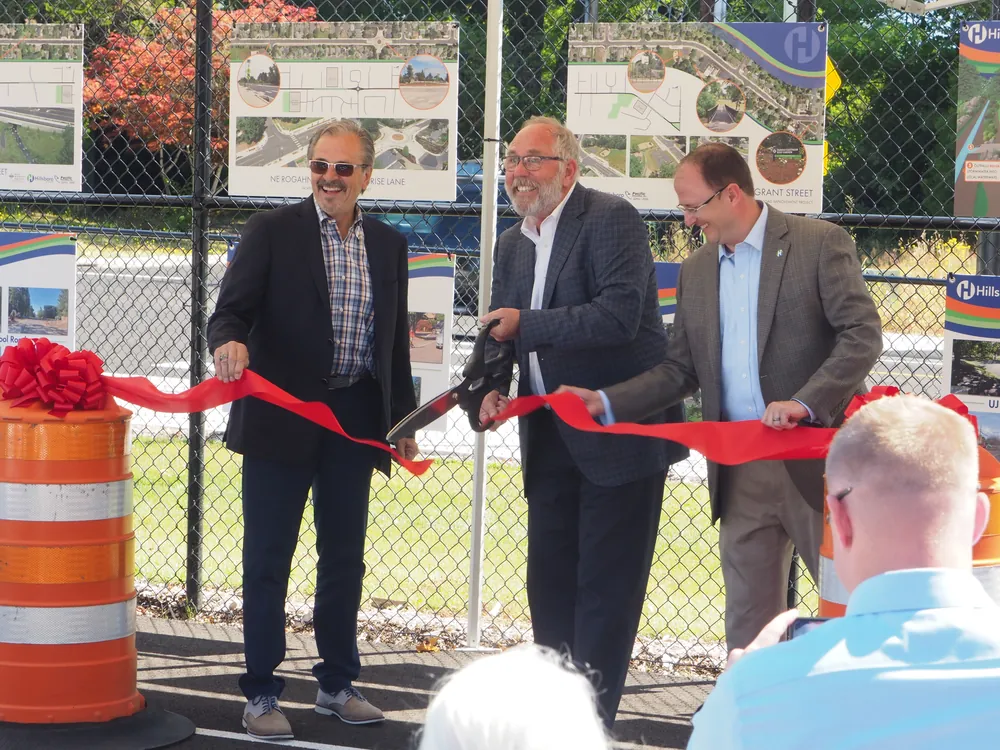
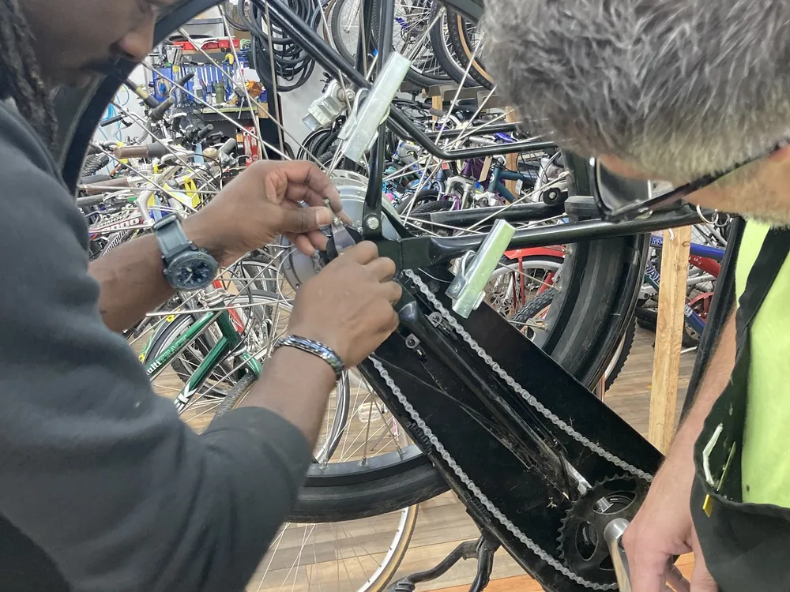
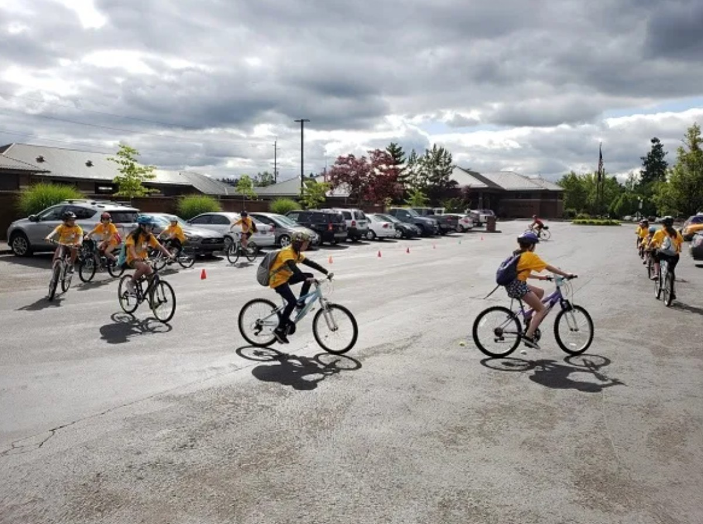
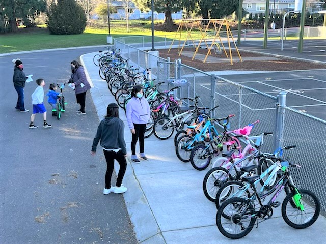
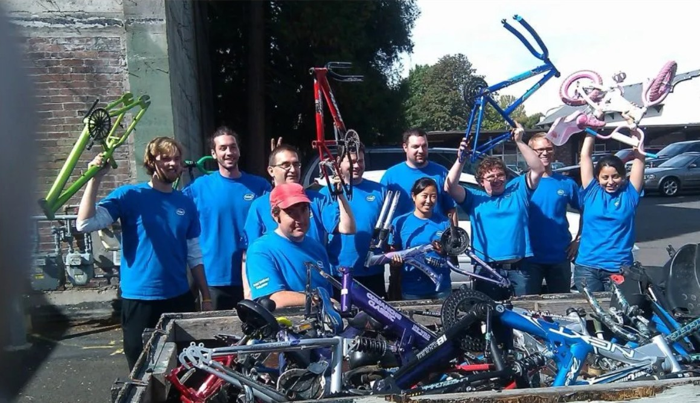
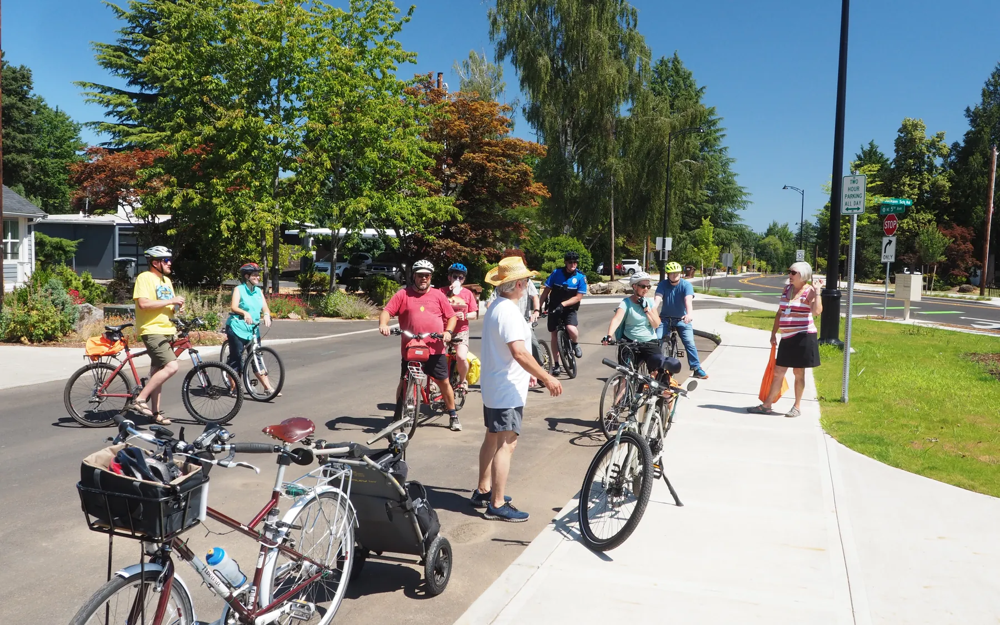
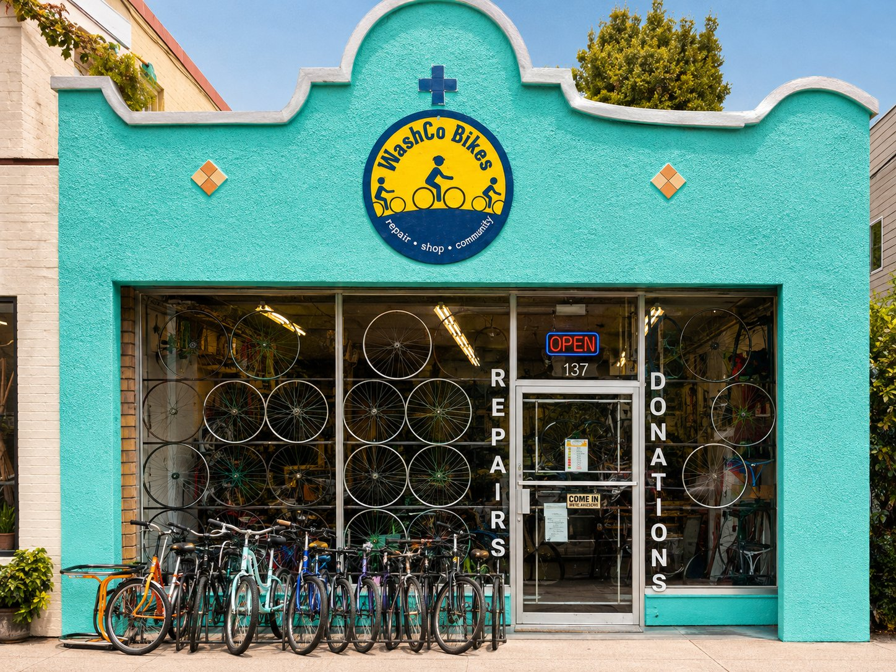

*Washington County's bicycle nonprofit*

## Bicycling opens doors. We help more people ride.

A bicycle can mean independence, affordable transportation, better health, outdoor fun, and a stronger connection to community. WashCo Bikes helps make that possible through education, advocacy, and our nonprofit Cycling Center.

<h2 id="serve">One mission. Three ways we serve.</h2>

### Better bicycling starts with skills, access, and safer communities.

From the first pedal to everyday transportation, WashCo Bikes helps people build skills, gain access to bicycles, and ride in communities that work better for everyone.

#### Education: Skills first. Confidence follows.

Learn to ride, return after time away, improve bike handling, practice safe cycling, join community rides, or build mechanical know-how.

[Explore education →](/programs/education)

#### Advocacy: Safer streets. Better connections.

We support practical bicycle infrastructure, informed transportation decisions, and communities where people of all ages and abilities can ride comfortably.

<!-- TODO: no advocacy page exists in the repo yet. The concept linked to advocacy.html. -->
[Learn about advocacy →](/about)

#### Cycling Center: A bike shop with a bigger purpose.

Affordable new, used, and refurbished bikes, full-service repairs, parts, accessories, helmets, and friendly help—supporting our nonprofit mission.

[Visit the Cycling Center →](/shop)

<h2 id="mission">Our mission</h2>

### Make bicyclists and bicycling better in Washington County.

Through education, encouragement, and advocacy, we create practical next steps for people who want to ride, return to riding, find a bicycle, or help build better bicycling conditions.

- **Learn** — Build skills and confidence at any stage.
- **Ride** — Put those skills to work in the real world.
- **Connect** — Strengthen access, community, and safer streets.

<h2 id="education">Education pathway</h2>

### Learn. Build confidence. Ride safely.

Our cycling education meets riders where they are. Youth and adults can start with the basics, improve specific skills, learn safe real-world riding, and then put those skills into practice on community rides.

*Learn or return to riding · Ride with confidence · Safe cycling · Community rides*

- Youth & adult learning
- Riding confidence
- Youth Safe Cycling, ages 12–15
- Adult Safe Cycling, age 15+
- Youth Safe Riding Camps
- Bike repair clinics & rodeos

[View education programs](/programs/education) · [Ask a Riding Coach](mailto:classes@washcobikes.org)

<h2 id="access">Access & opportunity</h2>

### Give a bike. Give time. Create opportunity.

Donated bicycles and volunteer effort help turn unused bikes into transportation, independence, education, and new adventures.

#### Adopt-a-Bike & community access

WashCo Bikes partners with schools, social-service agencies, community organizations, and public-safety partners to connect eligible youth and adults with bicycles and essential safety equipment.

[Support Adopt-a-Bike](/programs/adopt-a-bike) · [Volunteer](/get-involved)

## Community powered

### There is more than one way to move the mission forward.

Ride with us, learn with us, volunteer, donate a bicycle, become a member, or support the work financially.

#### Your time keeps the community rolling.

Mechanical experience is welcome, but it is not required for every role. Help with cleaning, repairs, education, events, advocacy, customer support, communications, or a group service project.

[Find your volunteer role →](/get-involved)

#### Show up. Ride. Connect.

Classes, rides, clinics, and community events give people a low-pressure way to build skills, meet other riders, and become part of the bicycling community.

[See upcoming events →](/events)

<h2 id="get-involved">Get involved</h2>

### Choose the next step that fits you.

Every path helps create more opportunities to ride in Washington County.

- [**Volunteer**](/get-involved) — Use your skills—or learn new ones.
- [**Donate**](/get-involved/join-or-donate) — Support programs, bikes, and access.
- [**Donate a bike**](/get-involved/join-or-donate) — Give an unused bicycle a second life.
- [**Join an event**](/events) — Classes, rides, clinics, and community activities.

<h2 id="visit">Visit us in Hillsboro</h2>

### WashCo Bikes Cycling Center

Stop in for bikes, repairs, parts, safety equipment, donations, or simply a little friendly bike help.

**137 NE 3rd Ave**\
**Hillsboro, OR 97124**\
503-844-9740\
[shop@washcobikes.org](mailto:shop@washcobikes.org)

#### Current public hours

| | |
|---|---|
| Monday–Saturday | **10 AM–5 PM** |
| Sunday | **Noon–4 PM** |

[Cycling Center details](/shop) · [Contact WashCo Bikes](/contact)

---

## Classes, rides, clinics & community events.

[See upcoming events](/events)
