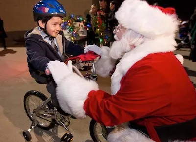

<h2 id="about-the-program">Supporting our community</h2>

WashCo Bikes is committed to serving the diverse communities throughout Washington County. We provide access to bicycles, helmets, and essential safety equipment, so people not only get the tools they need but also benefit from education and encouragement around cycling.

We partner with schools, social service agencies, community and faith organizations, and local police and fire departments. These partnerships help us connect with community members who need a bike for transportation, personal health, or general well-being.

Adopt-a-Bike is our largest fundraising effort each year. Community donations make it possible for us to continue our mission, and your contribution can make a real difference:

* **$150** provides a child with a bicycle.
* **$200** sponsors an adult bike package.
* **Any amount** is appreciated and helps us reach more people in need.

<h2 id="ways-to-help">Ways to help</h2>

#### Donate

Adopt a bike for a child or adult, or give any amount toward the program.

<a class="btn btn--primary" href="https://washcobikes.wufoo.com/forms/x184wxtx1rpujow/">Donate now</a>

#### Enlist your employer

Ask whether your employer uses a matching gift platform such as Benevity. If so, give through it and your employer can double your donation. Employers can also sponsor a set number of bikes, helmets, or locks, or a bike rodeo for employees' children.

<a class="btn btn--outline" href="https://washcobikes.wufoo.com/forms/z9uo0iu0fv4zfb/">Corporate donations</a>

#### Volunteer

Help refurbish bikes! Volunteer hours are crucial to this program, and your time and skills directly prepare bikes for distribution.

<a class="btn btn--outline" href="https://washcobikes.wufoo.com/forms/mj4go0f08z1znp/">Sign up to volunteer</a>

#### Spread the word

Share the program with friends, family, and your social networks. The more people who know, the more bikes we can refurbish and give away.

<h2 id="stories">Adopt-a-Bike stories</h2>

#### Sarah's story

> “As a single mother, I struggled with transportation. Thanks to Adopt-a-Bike, I now have a bike to take my kids to school, go to work, and run errands. It's given me so much freedom and peace of mind!”

#### John's story

> “I served in the military and struggled to get around after I returned. Receiving a bike has helped me reconnect with my community, get to appointments, and even start a new job. I can't thank you enough!”

**Thank you for your support!**

<!-- TODO: "Special Thanks to Our Sponsors" was an empty table on the live
     site (the sponsor logos didn't migrate). Add a sponsor grid here once we
     have the current list and logos. -->
