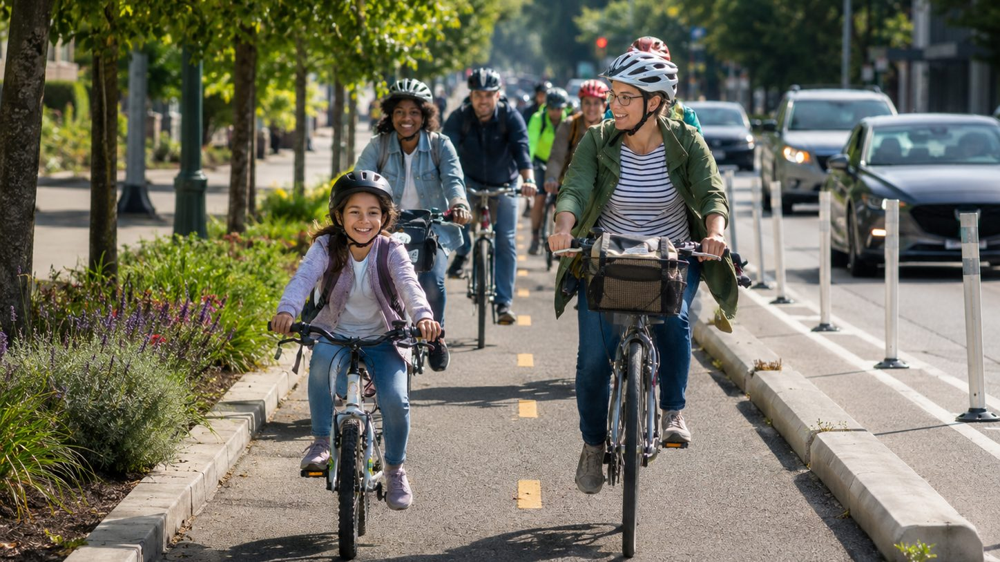
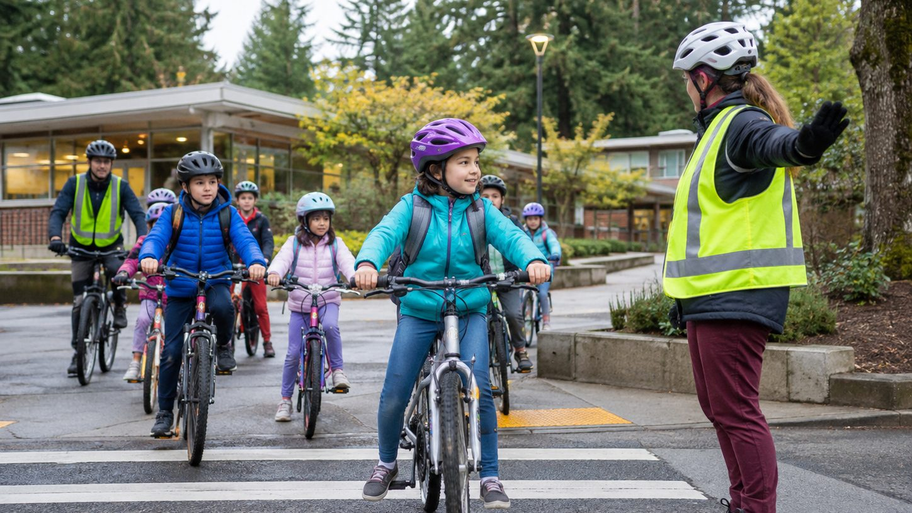
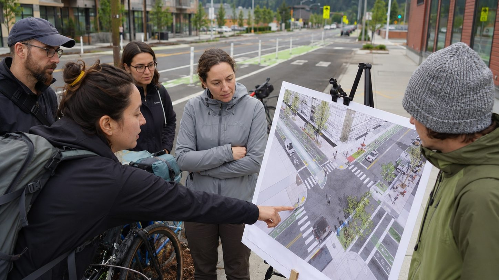
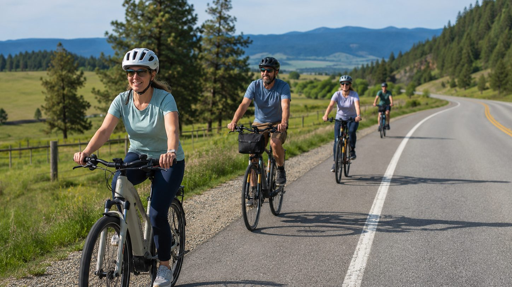

WashCo Bikes has been a voice for Washington County's bicycling community since 1998. We bring the perspective of everyday bicyclists—youth, families, commuters, recreational riders, older adults, and people just getting started—into conversations about schools, streets, transportation plans, and public investment.

<h2 id="how">From school parking lots to county transportation plans</h2>

Advocacy is more than asking for bike lanes. It means helping decision-makers understand how streets work for real people, supporting programs that build safe riding habits, and making sure bicycling is considered when Washington County plans for growth.

Events, education, encouragement, and advocacy reinforce one another. More people riding creates stronger demand for safe infrastructure—and better infrastructure makes it easier for more people to ride.

<h2 id="safe-routes">Helping students get to school safely and confidently</h2>

Washington County's Safe Routes to School program brings transportation and education leaders together to encourage children to walk and bicycle safely to school. It relies on partnerships among agencies, schools, community organizations, and neighborhoods, and WashCo Bikes is part of that support system. We help students and families build the skills and confidence to walk and bike to school safely through:

* Bike rodeos and age-appropriate bicycle safety education
* Support for school coordinators and family-facing events
* Bicycle safety checks and light maintenance support
* Helmet fit, visibility, and safe-riding guidance
* Real-world feedback about routes, crossings, and barriers students encounter

[Washington County Safe Routes to School](https://www.washingtoncountyor.gov/lut/improving-school-access) · [WashCo Bikes education programs](/programs/education)

<h2 id="planning">Bringing the bicyclist's perspective to a complicated system</h2>

Bicycling in Washington County is shaped by many jurisdictions and agencies. We follow the plans, projects, and public processes that affect where and how people ride—roadway projects, bicycle networks, crossings, trails, and the connections between neighborhoods, schools, jobs, transit, and community destinations.

#### Washington County LUT

County transportation planning, bicycle and pedestrian planning, the Transportation System Plan, and the Active Transportation Plan.

#### Metro

Regional transportation planning, funding priorities, trails, and connections that cross city and county lines.

#### ODOT

State highways and facilities that often form critical links—or barriers—in Washington County's bicycle network.

#### Cities & transit

Washington County's 13 cities, plus TriMet and other partners whose streets, transit stops, and local projects connect the county.

> A bicycle trip does not stop at a city boundary. Our advocacy looks at the whole trip—from the rider's front door to school, work, shopping, transit, parks, and the next community.

<h2 id="priorities">Comfortable, connected bicycling for all ages and abilities</h2>

Our [mission](/about#mission) guides the priorities we bring to public conversations:

* Connected bicycle networks instead of isolated segments
* Facilities that feel comfortable to everyday riders, not only experienced cyclists
* Safer crossings, intersections, and school access
* Maintenance and design that keep bikeways usable year-round
* Practical connections to transit, jobs, schools, shopping, parks, and trails
* Policies and investments that treat bicycling as real transportation

## See a gap, hazard, or opportunity?

Tell us what you are seeing on Washington County streets and paths. Rider experience helps us understand where advocacy, education, and community attention can make a difference.

<a class="btn btn--primary" href="/contact">Contact WashCo Bikes</a>

