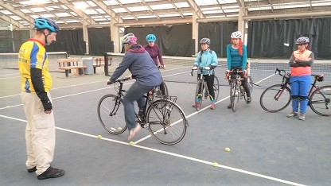
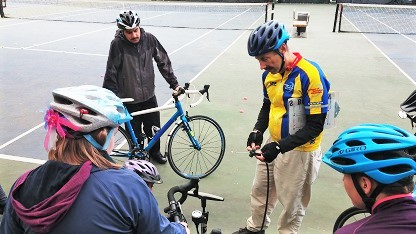
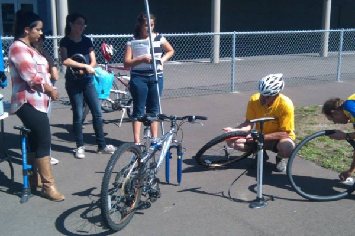
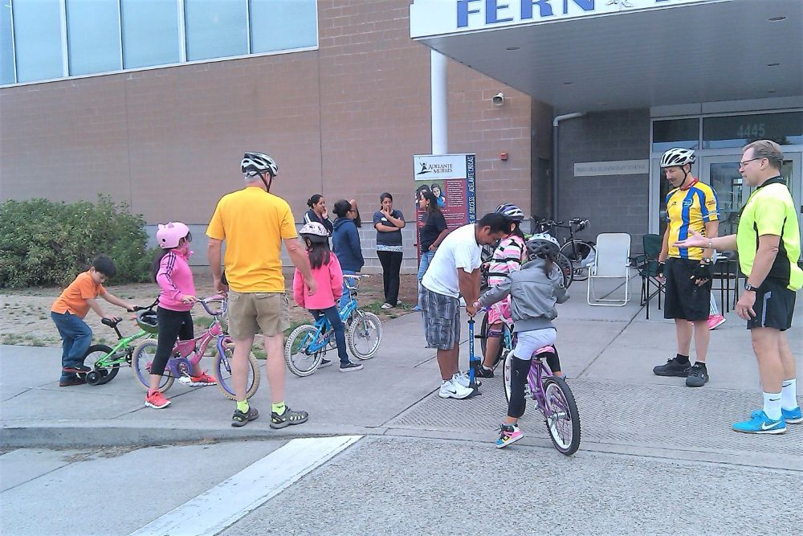

<h2 id="programs">Find the right class</h2>

#### Bike Repair Clinics

Learn to fix flats, adjust brakes and gears, and keep your bike rolling. Free with a refundable deposit.

[About repair clinics →](#repair-clinics)

#### Smart Cycling Workshop

For riders who already ride and want to feel safer and more prepared on streets, paths, and in traffic.

[About Smart Cycling →](#smart-cycling)

#### Skills and Safety Rodeos

Fun bike-handling games and safety checks for schools, community groups, and events of up to 50 people.

[About rodeos →](#rodeos)

<h4>Learn to Ride</h4>

One-on-one sessions for kids learning for the first time and adults learning or returning to riding.

[About Learn to Ride →](#learn-to-ride)

<h2 id="repair-clinics">Bike Repair Clinics</h2>

Want to learn how to adjust, clean, and repair your bicycle in a friendly, encouraging atmosphere? Bring your bike to one of our Bike Repair Clinics, and our qualified instructors will teach you how to maintain and fix it.

### What you'll learn

* Fix flat tires
* Adjust seats and handlebars
* Adjust the derailleur
* Adjust brakes
* Clean the chain
* Repair and replace the chain
* Check for broken spokes
* Remove wheels for transport
* And much more!

### Details

* **When:** The third Tuesday of every month, 5:30–7:00 PM. Specific dates are on the registration form.
* **Where:** Washington County Community Bicycle Center, 137 NE 3rd Ave, Hillsboro, OR 97124
* **Cost:** Free, with a $20 deposit to hold your place. After the clinic, we can refund it or you can make it a donation to WashCo Bikes. Tell us which when you sign in.

Grab a friend and have some fun!

<a class="btn btn--primary" href="https://washcobikes.wufoo.com/forms/zj5khbd0nh9xar/">Register for a repair clinic</a>

<h2 id="smart-cycling">Smart Cycling / Safe Riding Workshop</h2>

Ride with more confidence, more awareness, and a better plan for the road ahead.

The Smart Cycling / Safe Riding Workshop is for riders who already know how to ride and want to feel safer and more prepared riding on streets, paths, bike lanes, and through everyday traffic situations. This hands-on workshop helps riders move beyond simply staying upright and begin riding with purpose: seeing hazards earlier, communicating clearly, choosing good lane position, and understanding how to “drive” a bicycle predictably and confidently.

This workshop is a great next step for riders who want to commute by bike, ride more comfortably around town, join group rides, ride with family, or simply feel less uncertain when sharing the road with cars, pedestrians, and other cyclists.

Students will learn and practice practical Smart Cycling skills, including scanning, signaling, lane positioning, hazard avoidance, group riding awareness, basic bicycle safety checks, and the core habits of safer riding: Ride Ready, Be Predictable, Be Conspicuous, Think Ahead, and Follow the Law. Students will also receive a Smart Cycling manual to keep as a reference after the workshop.

This is not a Learn to Ride class. Riders should already be able to start, stop, steer, brake, shift, and ride comfortably before attending. If you are a new or returning rider who needs help with basic riding confidence first, please consider our [Adult Riding Confidence class](#learn-to-ride).

### How the workshop works

The workshop has two parts:

1. **Online instruction and testing.** Students complete the online learning portion at their convenience before the on-bike session. A score of 80% or higher is required to complete this portion. This helps riders arrive with a shared understanding of the basic concepts so the in-person time can focus on practice, coaching, and real-world application.
2. **Hands-on, on-bike instruction.** The on-bike session typically lasts 3–4 hours, depending on class size, rider skill levels, and conditions. It begins in a parking lot or similar controlled area where students practice bike handling, safety checks, scanning, signaling, hazard avoidance, lane positioning, and other core riding skills.

The workshop then moves to a supervised group ride on local streets, where students apply what they learned in real riding situations with instructor guidance and support. This is where the concepts become practical: reading the road, making safer choices, riding predictably, and building confidence one decision at a time.

At the end of the workshop, students complete a short feedback form, and the instructor completes a road test score sheet to document the skills practiced and demonstrated.

### What to bring

A bicycle in safe working order, a properly fitting helmet, water, snacks, and clothing appropriate for the weather. Helmets are required.

### Details

* **Cost:** The full course value is $250. WashCo Bikes subsidizes this workshop so riders pay **$75**. Grants and scholarships may be available when cost is a barrier.
* **Registration:** Closes 7 days before each workshop to allow time for the online instruction and testing. Class size is limited, so register early. After registering, you'll be taken to the payment page.

<a class="btn btn--primary" href="https://washcobikes.wufoo.com/forms/q1epnkj31cz4pxu/">Register for Smart Cycling</a>

<h2 id="rodeos">Skills and Safety Rodeos</h2>

WashCo Bikes hosts and stages skills and safety bike rodeos for schools, churches, recreation centers, municipalities, specialty events, and festivals.

### What is a bike rodeo?

A chance for people of all ages to improve their safety and bicycle skills through fun educational activities, including following games, foot-down races, slow races, obstacle courses, turns, and stops.

### Details

* **Group size:** All ages, up to 50 people
* **Length:** 60–120 minutes
* **We provide:** Instructors, equipment, programming, light repair and bike safety checks, free helmets, lights, and written educational material
* **Cost:** $250. After you fill out the registration form, you'll be taken to the payment page, and we'll contact you to arrange a date and time for your event.

<a class="btn btn--primary" href="https://washcobikes.wufoo.com/forms/mgkxazx1fo7a0a/">Book a rodeo</a>

<h2 id="learn-to-ride">Learn to Ride: Riding Confidence for All Ages</h2>

Whether you are learning for the first time, helping a child move beyond training wheels, or returning to bicycling after time away, WashCo Bikes can help you build confidence one step at a time.

Our riding confidence classes are friendly, supportive one-session lessons for youth and adults who are ready to learn, return, or feel more comfortable on a bicycle. The goal for every rider is the same: to feel steadier, safer, and more confident.

These classes use a calm, balance-first approach. Riders practice the skills that matter most at the beginning: bike fit, helmet fit, balance, braking, starting, stopping, steering, and pedaling when ready. Instruction is paced to the rider, with encouragement and simple coaching at each step.

#### Youth Learn to Ride

For children who are learning to ride for the first time, moving beyond training wheels, or needing extra help with balance and basic bike control.

Riders must be at least 6 years old. Sessions are usually one-on-one, although siblings or friends may be scheduled together when appropriate.

#### Adult Riding Confidence

For adults who are learning to ride for the first time, returning after time away, or looking for a refresher before riding more often.

This class meets riders where they are. Some focus on balance, braking, and pedaling. Others work on starting, stopping, scanning, signaling, turning, or feeling more comfortable in everyday situations.

### Details

* **Format:** One session of up to one hour, based on rider needs and progress. Instruction is usually one-on-one so riders can learn at a comfortable pace.
* **What to bring:** A bicycle in safe working order, a properly fitting helmet, water, and flat closed-toe shoes. Helmets are required.
* **Cost:** **$75 per student.** Grants and scholarships may be available when cost is a barrier. More than one student may be included when appropriate, such as siblings or friends learning together.
* **Upcoming small-group classes:** Saturday, August 22; Saturday, September 12; Saturday, November 14
* **Scheduling:** Register and pay using the button below, and a WashCo Bikes cycling instructor will contact you to schedule the session.

<a class="btn btn--primary" href="https://washcobikes.wufoo.com/forms/m1dwspeh1uk2ygj/">Register for Learn to Ride</a>

### Keep building confidence

After a Riding Confidence session, riders who want to keep building skills can take our [Smart Cycling / Safe Riding Workshop](#smart-cycling). It combines online learning with hands-on, on-bike instruction to build awareness, scanning, signaling, predictable riding, hazard avoidance, and confidence in real-world riding conditions.
